# car-selection-assistant

基于真实车型数据的汽车选择推荐平台：**确定性筛选与评分**打底，**LLM 对话式交互**呈现；
所有车辆事实只来自数据库与工具返回值，并带来源引用与缺失标记（「官方资料未披露」）。

[](LICENSE)


> 在线体验：<https://hp-car-selection-assistant.cn>
> 规模（生产）：1,102 个在售车系 · 7,888 个 SKU · 842,997 条参数事实 · 14,032 条检索切片

## 目录

- [这是什么](#这是什么)
- [功能特性](#功能特性)
- [架构总览](#架构总览)
- [快速开始](#快速开始)
- [配置](#配置)
- [质量与评测](#质量与评测)
- [部署与 CI 门禁](#部署与-ci-门禁)
- [测试与工程门禁](#测试与工程门禁)
- [安全实践](#安全实践)
- [项目结构](#项目结构)
- [文档](#文档)
- [License](#license)

## 这是什么

一句话：**用数据库算答案，用大模型把答案讲清楚**。

选车是一个约束密集、事实密集的问题。把预算、能源类型、座位数等硬约束交给模型「自由发挥」，
短期看很聪明，长期一定错——推荐了不满足条件的车，或者编造了库里没有的参数。所以本项目的做法是：

1. **硬约束走确定性路径**：筛选、推荐、销量榜、对比差异全部由 SQL + 规则引擎计算，可复现、可解释；
2. **LLM 只做理解与表达**：把自然语言解析成约束、把计算结果组织成自然回答，不生成车辆事实；
3. **每个数字都有来源**：回答携带证据引用，库内缺失的参数显式标注而不是猜；
4. **一切策略用数据决策**：检索/评分/交互的关键选择都有同题库 A/B 或消融实验，见 [docs/evaluation.md](docs/evaluation.md)。

## 功能特性

- **对话式选车 Agent**：预算 / 能源类型 / 车身形式 / 座位数 / 品牌等硬约束确定性解析；
  车系锁定与追问澄清；新约束与锁定车系冲突时自动解锁并在同一次回复中说明；
  盘点类问题（「奔驰都有哪些车型」）走确定性读库，不靠模型记忆。
- **说不清需求也能拿到车**：只有预算时**先给车、再问细节**；无软线索时按最近一个月销量排序；
  用户说「都可以」即视为放弃该项，不再重复追问。
- **确定性推荐引擎（评分 v2）**：硬约束下推 SQL（宁可少推不可推错）；七维评分
  （用途 / 空间 / 用车成本 / 动力 / 安全配置 / 舒适配置 / 智能配置），全部按**同价位分位**比较，
  固定锚点、候选池变化不改分；缺数据按中性处理并披露 coverage 与低证据。设计见
  [docs/scoring-v2-design.md](docs/scoring-v2-design.md)。
- **RAG 检索（LangGraph）**：查询理解（实体解析 + 意图分流 + 同义扩展）→ BM25 ∥ 稠密并行召回 →
  **加权 RRF 融合** → 按意图条件重排 → 证据把关；稠密后端支持进程内 / Milvus / Zilliz；
  `/ops/rag` 提供水位自证、重建进度与逐节点轨迹。详见 [架构总览](#架构总览) 与
  [docs/rag-retrieval-architecture.md](docs/rag-retrieval-architecture.md)。
- **跨车系对比与版本差异**：SKU 级对比表（隐藏相同参数）+ 确定性差异分析（一句话结论、
  关键差异 Top3、维度明细折叠）；同车系版本问答只列差异项，缺失一律标注。
- **销量 / 热门榜确定性回答**：取最近有销量数据的月份的前十车系月销（零售优先、门户回退），
  库内没有数据就明确说没有，不凭印象编榜单。
- **诚实性与可追溯**：不可回答题 60/60 显式标注缺失；回答中的数字与句子可追溯到证据
  （确定性模板可追问率 100%）；答案层用 LLM-as-judge 双评 + 数据库事实双度量。
- **跨会话偏好记忆**：匿名哈希标识保留预算 / 用途 / 排除项，可逐条查看、撤回、导出、删除；
  生产当前处于**观察档**（只记录不生效），切换生效前需先看隐私页与 `DURABLE_PREFS_MODE`。
- **真实数据接入**：汽车之家销量榜 / 车系 / SKU 三阶段抓取（断点续传），导入前 dry-run 校验、
  失败整体回滚；管理后台提供导入审计、质量冲突处理与 RAG 运维。

## 架构总览

系统分为「数据面」「检索面」「对话面」三层：数据面保证事实正确，检索面保证证据可召回，
对话面只做理解与表达。

### RAG 检索全流程



*图 1 · RAG 检索全流程（交互版：[rag-flow.html](docs/diagrams/rag-flow.html)，可展开节点 / 切换深浅色）*

流程要点：

- **摄取**：真实数据抓取 → LangGraph 摄取流水线（load → chunk → index）→ 稀疏 BM25（bigram +
  车系专名运行期注册）+ 稠密向量（qwen3.7-text-embedding-flash · 1024 维 · 款型级合并切片，
  向量缓存断点续跑）；月度销量入库触发稠密增量重建（无新月度零成本跳过）。
- **查询**：实体解析 / 意图分流 / 同义扩展 → 双路并行召回（每路 top_k × 6）→ 加权 RRF（0.6 / 0.4，
  k=60）→ 条件重排（仅 semantic / recommend，实体锚定查询跳过）→ 证据把关。
- **作答**：Agent 带证据引用回答，缺失参数显式标注；`/ops/rag` 可视化全链路与水位自证。

### Agent 对话与工具调用链



*图 2 · Agent 请求 / 工具调用链（交互版：[agent-chain.html](docs/diagrams/agent-chain.html)）*

原则：**模型不碰事实**。LLM 只负责把用户话术解析成结构化约束、选择工具、组织表达；
召回、筛选、评分、对比、销量计算全部由确定性工具完成，回答中的数字受白名单校验。

### 技术栈

| 层 | 技术 |
|---|---|
| 后端 | FastAPI · SQLAlchemy 2.0 · Alembic · Pydantic v2（SQLite 开发 / PostgreSQL 生产） |
| 会话与限流 | Redis（compose 内置；未配置时回退进程内实现，接口一致） |
| Agent | LLMClient 适配层（OpenAI 兼容 API；未配置 LLM 时自动降级为确定性回答） |
| RAG | LangGraph StateGraph · 进程内 BM25 / Milvus / Zilliz 稠密召回 · 可插拔重排 |
| 前端 | Next.js 15 · React 19 · TypeScript · Tailwind CSS |
| 评测 | 自建零标注黄金题库 + 多口径检索指标 + LLM-as-judge（见 [质量与评测](#质量与评测)） |

## 快速开始

### 环境要求

- Python 3.11+，Node.js 20+/pnpm，Docker（仅生产部署需要）
- 可选：Redis、PostgreSQL、Milvus / Zilliz（不配置时自动使用进程内实现与 SQLite）

### 后端

```powershell
cd backend
python -m venv .venv
.\.venv\Scripts\Activate.ps1          # bash: source .venv/bin/activate
pip install -r requirements.txt
Copy-Item .env.example .env           # bash: cp .env.example .env
# 编辑 .env：DATABASE_URL 默认 SQLite 即可跑通；DEEPSEEK_API_KEY 留空则确定性回答
alembic upgrade head
python -m uvicorn app.main:app --reload --port 8000
```

### 前端

```bash
cd web
pnpm install
pnpm dev                              # http://localhost:3000
```

### 导入车型数据（可选）

导入真实数据后才能体验完整功能（空库会返回「暂无数据」类回答）：

```powershell
cd backend
# 销量榜（某月，门户口径）
python tools/fetch_autohome_sales.py --month 2026-07 --do-import
# 全量车系与 SKU（index / series / sku 三阶段，断点续传；--no-import 只抓不导）
python tools/fetch_autohome_sku.py --stage index
# 校验导入载荷（先 dry-run，失败整体回滚）
python tools/import_data.py payload.json --dry-run
```

数据抓取请遵守目标站点 robots.txt 与服务条款；本项目仅抓取公开页面（门户口径），
仅供学习研究使用。

## 配置

复制 [backend/.env.example](backend/.env.example) 后按需填写，全部有默认值，**零配置可跑通开发模式**：

| 变量 | 说明 |
|---|---|
| `DATABASE_URL` | 默认 SQLite；生产用 `postgresql+psycopg://...` |
| `DEEPSEEK_API_KEY` / `DEEPSEEK_BASE_URL` / `DEEPSEEK_MODEL` | OpenAI 兼容 LLM；留空 = 确定性回答 |
| `REDIS_URL` | 会话 / 限流 / 验证码存储；留空 = 进程内实现 |
| `RETRIEVAL_BACKEND` | RAG 稠密召回后端：`inmemory`（默认）/ `milvus` |
| `RETRIEVAL_TOKENIZER` | 稀疏分词器：`bigram`（默认）/ `jieba` / `hybrid` |
| `RERANK_PROVIDER` | 重排器：空（默认，保持融合序）/ `lexical` / `api` |
| `ADMIN_API_TOKEN` / `ADMIN_API_TOKENS` | 管理后台凭据（多标签 `label:token` 可单独吊销）；留空 = 管理接口禁用 |
| `OSS_*` | 网页快照 / 图片原始文件存储（可选） |

完整配置项与生产取值说明见 [docs/deployment.md](docs/deployment.md)。

## 质量与评测

评测体系：零标注黄金题库（520 题主库 + 不可回答 60 + 多约束 80 + 口语化改写 163），
四桶分层；检索指标（Hit / MRR / NDCG / Recall）与 v2 语义约束指标（fact-coverage /
valid-hit / valid-precision / pair-coverage）双口径；答案层用 LLM-as-judge 双评 +
数据库事实一致性（faithful_db）双度量。**所有数字都对应可复现的报告**，指标含义、口径与
逐项来源见 [docs/evaluation.md](docs/evaluation.md)。

### 检索质量（451 题 · 生产配置 · 真云 dense）

| 指标 | 基线（2026-09） | 最新复测（2026-10-28） |
|---|---|---|
| Hit@5 | 0.6763 | 0.6763 |
| MRR | 0.6656 | 0.6659 |
| NDCG@5 | 0.6330 | 0.6511 |
| NDCG@10 | 0.6138 | **0.6397** |
| Precision@5 | 0.6182 | 0.6404 |

> 口径：`eval/questions.json` 中可解析锚点的 451 题；生产配置（Milvus/Zilliz 稠密 + 重排）。
> 最新复测语料为 1,102 车系 / 14,032 切片（较基线 908 车系 / 12,078 切片增长），
> 因此差异同时包含检索改进与数据更新。

### 语义约束与生成质量

| 指标 | 基线 | 最新复测 |
|---|---|---|
| fact-coverage@5（参数覆盖） | 0.7660 | 0.7660 |
| valid-hit@5（满足硬约束） | 0.7885 | **0.9872** |
| valid-precision@5 | 0.6064 | **0.9718** |
| pair-coverage@5（对比双侧覆盖） | 0.4390 | **0.5610** |
| 拒答通过率（60 题） | 60/60 | 60/60（100%） |
| 生成层 faithful_db（100 抽样） | 0.7765 | 0.4167†（非严格同条件，见 docs/evaluation.md） |
| 可追问率·确定性模板（数字级） | 100% | 98.4%（7956/8088） |

> 语义约束的 156 题判定队列固定（47 fact / 41 pair / 156 valid），基线取同一 451 题口径的
> `eval-v6b.json`；旧文档中 0.8136 / 0.6992 / 0.7607 来自 531 题运行（valid 队列 236），
> 与本表不可直接相减，修订说明见 [docs/evaluation.md §5](docs/evaluation.md#5-与旧-readme-口径的修订记录)。
>
> † 生成层本轮为非严格同条件：复测期间 DeepSeek 网络抖动触发工具循环回退（作答路径退化为普通对话），
> 且作答模型/提示与语料规模与基线不同；只作观测，不宜当回归结论，详见
> [docs/evaluation.md §3.4](docs/evaluation.md)。

### 策略选型（同题库 A/B 实测，非经验拍板）

| 决策点 | 选型 | 实测依据（520/451 题基准） |
| --- | --- | --- |
| 切分粒度 | 款型级合并切片 | Hit@5 **+2.0pt**（0.6519 → 0.6718），命中即对齐 SKU |
| 稀疏分词 | bigram | jieba 整词 0.6563 / 混合 0.6674，均低于 bigram 0.6718 |
| 召回融合 | BM25 ∥ 稠密 + 加权 RRF（0.6 / 0.4，k=60） | 稠密补语义洞；等权 0.6741 < 加权 0.6763 |
| 重排 | 按意图条件启用（仅 semantic / recommend） | 全链路最优 0.6763 / 0.6656；实体锚定查询（43%）上重排中性偏负且白付约 1s/题 |
| HyDE | 关闭 | 154 题语义桶扩样：Hit@5 −1.3pt 且耗时 +4.4× |
| CHUNK_SIZE | 500 / overlap 64 | 400 → 0.6630、600 → 0.6585，均劣化 |
| 召回倍数 | 6（每路 top_k×6） | 8 无增益 |
| 稠密定位 | 补语义洞，不替代稀疏 | dense 单路 0.6452 < sparse 0.6718；hybrid 0.6741 |

## 部署与 CI 门禁

生产环境为阿里云 ECS 上的 Docker Compose（nginx + api + web + redis），**只部署 main**：
每天 05:00 `deploy/carsel-deploy.sh` 对比 GitHub main 最新提交，**先校验该提交的
4 个必需 CI job 全绿**（backend / gates / web / migrations；不绿或查询失败都不部署），
再同步源码、重建镜像、切流，健康检查失败自动回滚到上一版镜像。


*图 3 · 部署 + CI 门禁流水线（交互版：[deploy-ci.html](docs/diagrams/deploy-ci.html)）*

CI 流水线（GitHub Actions）：

| Job | 内容 | 部署门禁 |
|---|---|---|
| `backend` | pytest 全量 + 覆盖率 | ✅ 必需 |
| `gates` | 密钥扫描 / UI 文案门禁 / 文档一致性 / pre-push 守卫 | ✅ 必需 |
| `web` | eslint + tsc + 前端测试 + next build | ✅ 必需 |
| `migrations` | 真实 PostgreSQL 上 alembic 迁移往返 | ✅ 必需 |
| `lint` | ruff（当前基线 129 条，仅报告） | — |
| `metrics` | 规模指标（仅报告，不阻塞） | — |
| `autofix` | 自动修格式（PR 场景） | — |

手工执行 `carsel-deploy.sh --check / --dry-run / --force` 可查状态、预演与强制重部署
（`--force` 也绕不过 CI 门禁，救火用 `DEPLOY_SKIP_CI_GUARD=1`）。部署形态、回滚、新机接入见
[docs/deployment.md](docs/deployment.md)；阿里云侧运维（续费 / 防火墙 / 快照 / RDS 账号与备份）
见 [docs/aliyun-ops.md](docs/aliyun-ops.md)。

## 测试与工程门禁

```powershell
cd backend
python -m pytest -q                   # 1743 用例（随迭代增长，以实际输出为准）
cd ..\web
pnpm exec tsc --noEmit                # 前端类型检查
pnpm exec eslint . --max-warnings 0   # 前端 lint（基线 0）
```

- **后端**：pytest 全量 + 覆盖率门槛（`fail_under=85`）；ruff 基线 129 条（仅报告，改动后不得上升）。
- **前端**：eslint 0 warning、TypeScript 严格检查、`next build` 通过。
- **静态门禁**：密钥扫描（`reviewer/scan_secrets.py`）、UI 文案门禁（`reviewer/scan_ui_copy.py`）、
  文档一致性（`skills/doc_sync_check.py`：用例数/迁移数/工具 schema 数、悬空引用、配置表、编码），
  三者均已接入 CI，判定真值以 git 索引为准（本地跑 == CI 跑）。

## 安全实践

- **凭据**：只经服务器 `.env`（权限 600）或平台环境变量注入，仓库仅保留 `.env.example` 占位；
  `.dockerignore` 排除 `.env` / 私钥 / 本地数据，密钥不进镜像层与构建缓存；轮换流程见
  [docs/credential-rotation.md](docs/credential-rotation.md)。
- **访问控制**：管理后台独立 Bearer 凭据（CSPRNG、多标签可单独吊销、常量时间比较，缺失 503 /
  无效 401），不开放注册；交互式 API 文档默认关闭。
- **限流**：按真实客户端 IP（仅信任本机 nginx 的 `X-Forwarded-For`，不可用 `*`）。
- **容器与网络**：端口只绑 `127.0.0.1`，Redis 不发布端口；`cap_drop: ALL`、`no-new-privileges`、
  内存与进程数上限；容器内**非 root** 运行（部署后有运行时断言，不满足即回滚）。
- **数据面**：车辆事实只来自数据库与工具返回值，LLM 无写权限、无执行工具；SQL 全参数化；
  图片代理为域名白名单（拒绝内网 / 元数据地址）；CORS 非通配。
- **已知待办**：RAG 数据面的并发与优雅降级加固（重建窗口期的请求隔离）。

## 项目结构

```
backend/
  app/
    admin/        # 管理后台 API（数据导入审计 / 质量冲突 / RAG 运维）+ 操作审计中间件
    agent/        # 对话引擎：约束解析、车系锁定与追问、版本差异问答、对比差异分析
    auth/         # 注册 / 登录 / 验证码（Redis 或进程内存储）
    brands/       # 品牌注册表与品牌盘点
    catalog/      # 车系索引与锁定
    common/       # 配置 / 数据库 / LLMClient 适配层 / 模型定义 / 限流 / Redis 客户端
    comparison/   # 跨车系对比（内容哈希幂等）+ 确定性差异分析
    images/       # 图片代理（域名白名单）
    rag/          # LangGraph 双流水线（查询 / 摄取）+ 同义扩展
    recommendation/  # 确定性推荐（硬约束下推 SQL + 评分）
    retrieval/    # BM25 / 稠密召回后端、分词器、重排配置、领域词表
    sales/        # 月度销量接口
    sources/      # 数据源适配与导入（汽车之家 SKU、能源类型判定）
    vehicles/     # 车型查询 / 车系搜索接口
    variants/     # 参数归一化（单位 / 工况 / 缺失值）
  alembic/        # 数据库迁移
  tools/          # 数据抓取 / 导入 / 评测 / 运维脚本
  tests/          # pytest 用例
web/
  app/            # Next.js 页面（首页 / 车型列表与详情 / 对比 / 收藏 / 隐私与 AI 声明 / ops 运维）
  lib/            # API 客户端、Agent 触发词、认证与筛选工具
skills/           # 开发工作流沉淀（数据校验 / 参数归一化 / 端到端验证 / 文档同步等）
deploy/           # Docker Compose、前后端 Dockerfile、Nginx 配置、自动部署 / 夜间任务 / 缺口回补脚本
reviewer/         # 独立代码审查 Agent（密钥扫描器 + UI 文案门禁 + 审查规范）
docs/             # 对外文档（部署与自动更新 / 阿里云运维 / 凭据轮换 / 评测指标 / 评分 v2 设计 / RAG 架构）
RAG.md            # RAG 子系统设计与运维文档
```

## 文档

| 文档 | 内容 |
|---|---|
| [docs/evaluation.md](docs/evaluation.md) | 评测指标含义、基线 vs 最新复测、口径修订与复现方式 |
| [docs/rag-retrieval-architecture.md](docs/rag-retrieval-architecture.md) | RAG 检索架构与选型依据 |
| [RAG.md](RAG.md) | RAG 子系统设计与运维手册 |
| [docs/scoring-v2-design.md](docs/scoring-v2-design.md) | 确定性评分 v2 设计 |
| [docs/deployment.md](docs/deployment.md) | 生产部署、自动更新、回滚与新机接入 |
| [docs/aliyun-ops.md](docs/aliyun-ops.md) | 阿里云控制台运维（续费 / 防火墙 / 快照 / RDS / OSS / 备案） |
| [docs/credential-rotation.md](docs/credential-rotation.md) | 凭据轮换流程 |

架构图（可交互）：

- RAG 全流程：[rag-flow.html](docs/diagrams/rag-flow.html) · 静态图 `docs/diagrams/rag-flow.svg`
- Agent 请求 / 工具调用链：[agent-chain.html](docs/diagrams/agent-chain.html) · 静态图 `docs/diagrams/agent-chain.svg`
- 部署 + CI 门禁流水线：[deploy-ci.html](docs/diagrams/deploy-ci.html) · 静态图 `docs/diagrams/deploy-ci.svg`

## 设计原则

1. **事实只来自数据库与工具返回值**：LLM 不生成车辆参数，回答附来源引用与缺失标记。
2. **硬约束确定性执行**：筛选与推荐不走「模型自由发挥」，宁可少推不可推错。
3. **密钥不落仓库**：`.env` 一律 gitignore，仓库只保留占位模板。
4. **本地无云依赖可运行**：SQLite + 进程内实现即可完成开发与测试闭环。
5. **策略用数据决策**：检索 / 评分 / 交互的关键选择以同题库 A/B 与消融实验为准，不符合预期的实现按数据回退。

## License

[Apache-2.0](LICENSE)
